# STALLA

**Gestion de stands de marché** : les administrateurs attribuent les stands, encaissent les loyers et suivent les dettes depuis le web ; les vendeurs consultent leur situation depuis leur téléphone.

| Composant | Techno | Dossier |
|---|---|---|
| API REST | Node.js · Express · Sequelize · MySQL | [`backend/`](backend) |
| Back-office web (admin) | React · TypeScript · Vite | [`stalla_web/`](stalla_web) |
| Application vendeur | Flutter (Android / iOS) | [`stalla_mobile/`](stalla_mobile) |

## Fonctionnalités

- **Stands** : zones A–D, catégories (standard, premium…), loyers mensuels.
- **Vendeurs** : création par l'admin, candidatures, mot de passe initial, réinitialisation par email.
- **Allocations & paiements** : attribution vendeur ↔ stand, encaissement, reçu PDF.
- **Dettes** : calcul automatique (job quotidien), rapport des débiteurs, taux de recouvrement.
- **Support** : numéro d'assistance configurable, affiché dans l'app mobile.

## Aperçu

### Web — back-office admin

| Connexion | Création de compte |
|---|---|
|  | 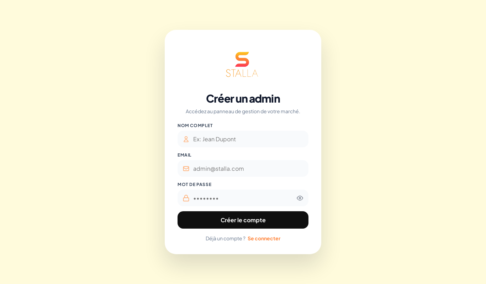 |
| **Dashboard** | **Gestion des stands** |
| 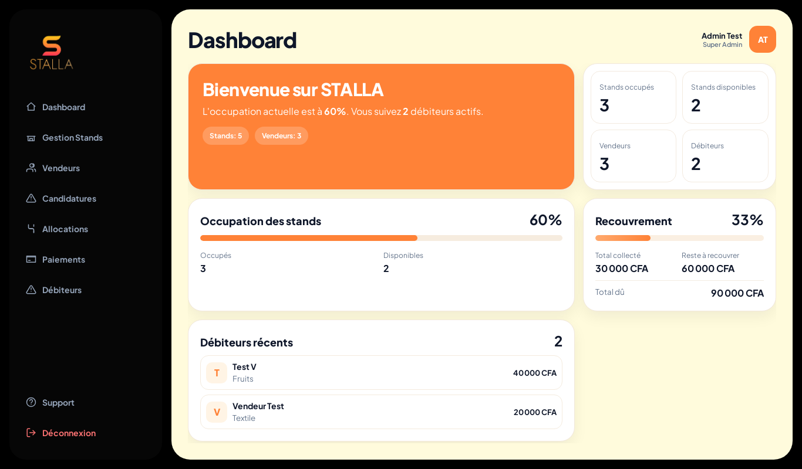 | 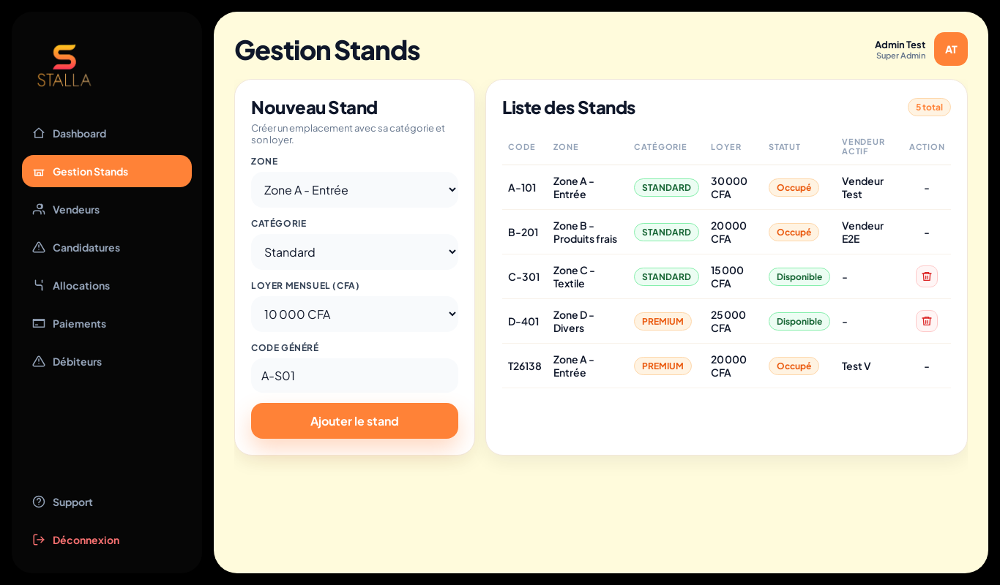 |
| **Vendeurs** | **Candidatures** |
| 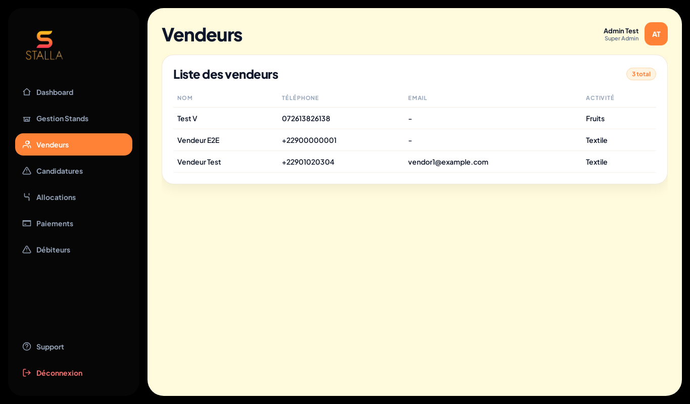 | 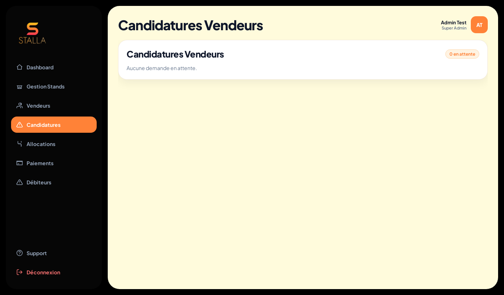 |
| **Allocations** | **Paiements** |
| 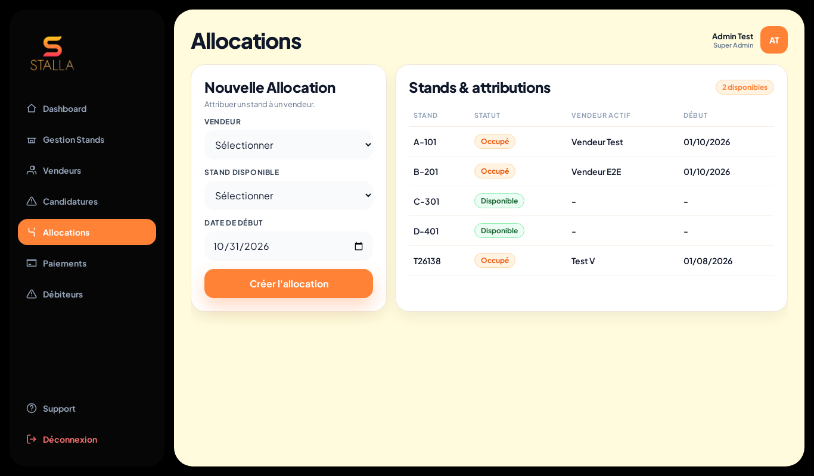 | 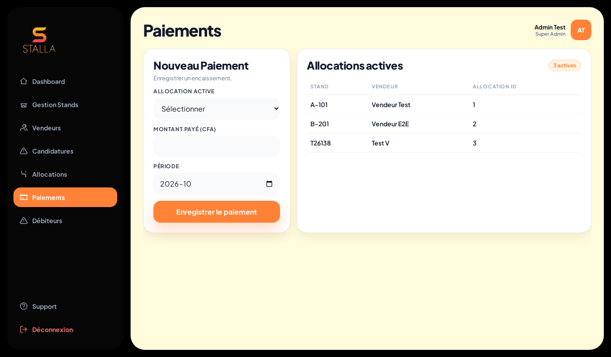 |
| **Débiteurs** | **Support** |
| 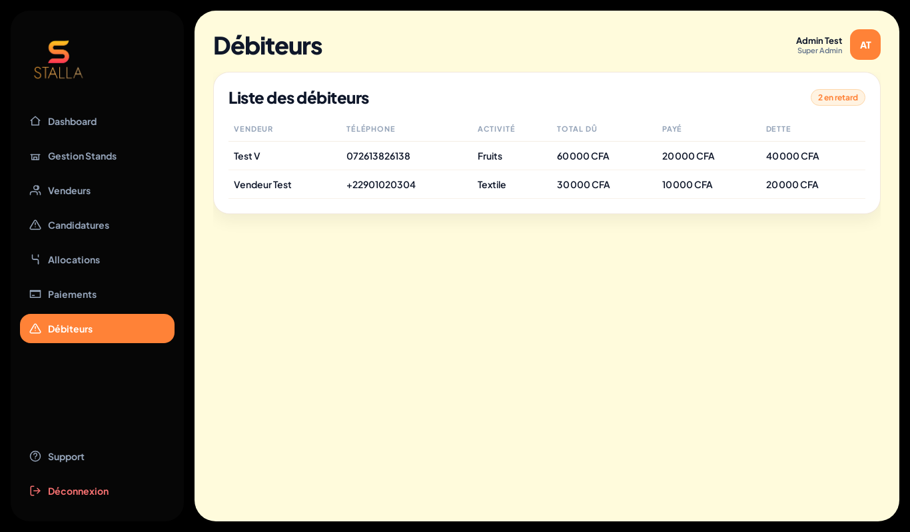 | 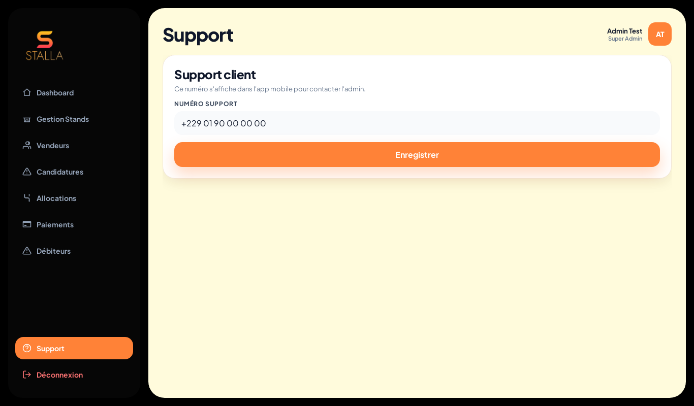 |

### Mobile — application vendeur

| Accueil public | Stands disponibles | Demande de stand | Connexion | Tableau de bord |
|---|---|---|---|---|
|  | 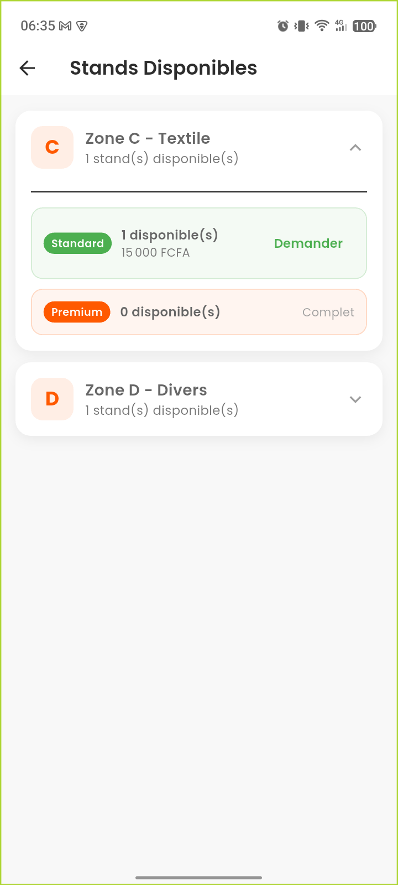 | 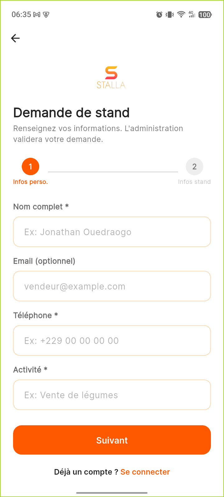 | 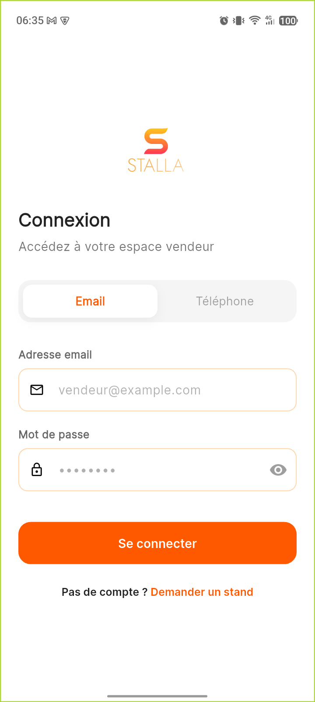 | 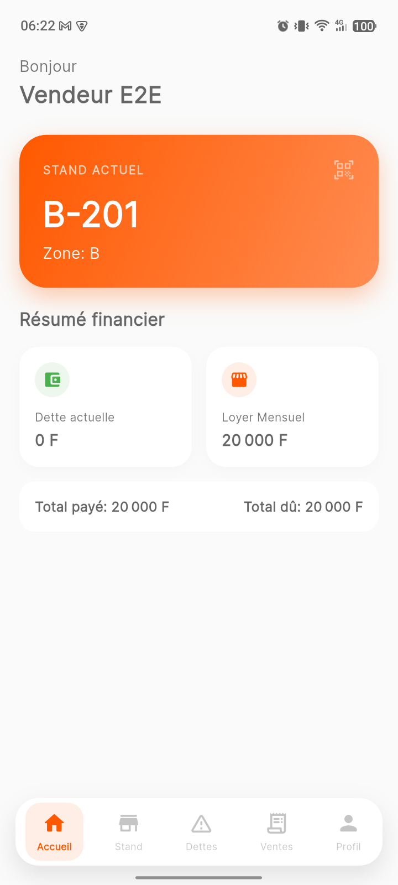 |

## Démarrage rapide

Seul Docker est requis (et `adb` pour le téléphone, optionnel).

```bash
infra/scripts/up.sh       # DB + API + web (crée backend/.env si absent)
infra/scripts/mobile.sh   # build APK + installation sur le téléphone USB
infra/scripts/down.sh     # arrêt (--purge : supprime base et caches)
```

- Web admin : http://localhost:5173
- API : http://localhost:4000 · Swagger : http://localhost:4000/api-docs
- MySQL : `localhost:3307`

Premier admin : page « Créer un compte » du web (ou `POST /api/auth/register-admin`).
Détails : [`infra/README.md`](infra/README.md) et [`docs/SETUP.md`](docs/SETUP.md).

## Documentation

| Document | Contenu |
|---|---|
| [`infra/README.md`](infra/README.md) | Dockerfiles, compose et scripts de lancement |
| [`docs/SETUP.md`](docs/SETUP.md) | Installation, configuration, mobile USB, dépannage |
| [`docs/ARCHITECTURE.md`](docs/ARCHITECTURE.md) | Structure du code et flux de données |
| [`docs/DOCUMENTATION_API.md`](docs/DOCUMENTATION_API.md) | Référence des endpoints |
| [`docs/GUIDE_POSTMAN.md`](docs/GUIDE_POSTMAN.md) | Tester l'API avec Postman |
| [`docs/CREER_VENDEUR_AVEC_DETTE.md`](docs/CREER_VENDEUR_AVEC_DETTE.md) | Scénario : vendeur avec dette |
