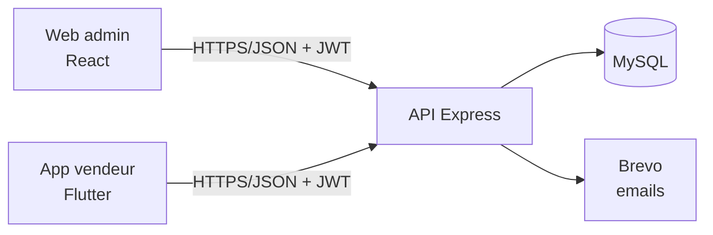

# Architecture

## Backend (`backend/src`)

| Dossier | Rôle |
|---|---|
| `routes/` | Déclaration des endpoints + annotations Swagger |
| `controllers/` | Couche HTTP : lit la requête, appelle un service, formate la réponse |
| `services/` | Logique métier (stands, allocations, paiements, dettes, PDF, emails) |
| `models/` | Modèles Sequelize et associations |
| `middlewares/` | Authentification JWT/rôles, gestion d'erreurs |
| `jobs/` | Tâches planifiées (calcul des dettes) |
| `config/` | Variables d'environnement, base de données, Swagger |
| `utils/` | Helpers (`AppError`, `asyncHandler`, format de réponse, calcul de dette) |

Rôles : `ADMIN` (`/api/admin/*`) et `VENDOR` (`/api/vendor/*`).

## Web (`stalla_web/src`)

Organisation par fonctionnalité : `features/<nom>/{pages,services,types}` (auth, dashboard, stalls, vendors, applications, allocations, payments, debtors, support).
`core/` contient le client API, le stockage de session et les types ; `shared/` les composants, hooks et layouts réutilisables.

## Mobile (`stalla_mobile/lib`)

| Couche | Contenu |
|---|---|
| `core/` | Constantes (URL de l'API), thème, formatters |
| `data/` | Modèles, repositories, client HTTP, stockage de session |
| `presentation/` | Providers (état), router, écrans, widgets |
